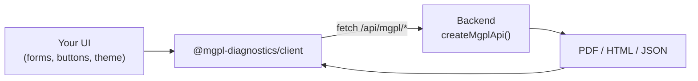

<div align="center">


# client

**The frontend SDK for MGPL Diagnostics: typed, headless, zero dependencies.**

Your UI, your design system, your UX. The backend renders the reports and invoices; this talks to it.

[](#)
[](#)
[](#)
[](#react-optional)
[](LICENSE)

[Quick start](#quick-start) · [SDK](#the-sdk) · [React](#react-optional) · [Errors & auth](#errors-and-auth) · [Docs](docs/api.md)

</div>

---


<p align="center"><sub>A result-entry form generated from <code>GET /templates</code>, with a live preview from the backend (the <a href="https://github.com/mgpl-diagnostics/report-studio">report-studio</a> demo). Every pixel of this UI is the app's own.</sub></p>

## Why a separate client

The backend kits ([report-kit](https://github.com/mgpl-diagnostics/report-kit), [invoice-kit](https://github.com/mgpl-diagnostics/invoice-kit)) carry a PDF engine,
a native SVG renderer and fonts. A frontend needs none of that. This package is all a browser app installs:

- **Headless.** No components with styling, no CSS, no layout. Build any UI/UX.
- **Zero dependencies.** About 4 KB, plus about 3 KB of optional React hooks.
- **Typed.** Request and response types for every route, checked against the backend kits at build time.
- **Any frontend.** React, Next.js, Vue, Svelte, plain JS, React Native. It only needs `fetch`.



## Quick start

```bash
npm i @mgpl-diagnostics/client
```

```ts
import { createMgplClient, downloadBlob } from "@mgpl-diagnostics/client";

const mgpl = createMgplClient({ baseUrl: "/api/mgpl" }); // or "https://api.your-lab.in/api/mgpl"

const pdf = await mgpl.reports.pdf({
  patient: { title: "Mrs", name: "Kavita Sharma", age: 32, sex: "Female", patientId: "MGPL1025" },
  tests: [{ template: "cbc", results: { hb: "10.8", wbc: "6700" } }],
});
downloadBlob(pdf, "MGPL1025.pdf");
```

## The SDK

| Call | Backend route | Returns |
|---|---|---|
| `mgpl.reports.templates()` | `GET /templates` | every test with its result fields + profiles |
| `mgpl.reports.pdf(req)` / `.html(req)` | `POST /report` | `Blob` (PDF) / `string` (HTML) |
| `mgpl.reports.letterheadPdf()` / `.letterheadHtml()` / `.letterheadUrl()` | `GET /letterhead` | stationery |
| `mgpl.reports.samples()` | `GET /samples` | demo reports (if enabled) |
| `mgpl.invoices.totals(invoice)` | `POST /invoice` (json) | totals, GST, status, amount in words |
| `mgpl.invoices.pdf(req)` / `.html(req)` | `POST /invoice` | `Blob` / `string` |
| `mgpl.invoices.priceList()` | `GET /price-list` | codes usable as invoice items |
| `mgpl.health()` | `GET /health` | `{ ok }` |

Browser helpers: `downloadBlob(blob, name)`, `openBlob(blob)`, `printBlob(blob)`.

**Build an entry form from the catalog.** Nothing about tests is hard-coded in your app:

```ts
const { templates } = await mgpl.reports.templates();
// templates[i] = { id: "cbc", name: "Complete Blood Count (CBC)", category: "Hematology",
//                  fields: [{ key: "hb", label: "Haemoglobin (HB)", unit: "g/dL", range: "12.0 - 15.0" }, …] }
```

## React (optional)

`@mgpl-diagnostics/client/react` adds **unstyled** hooks and one bare iframe. Pass your own `className`/`style`.

```tsx
"use client";
import { useRef } from "react";
import { createMgplClient } from "@mgpl-diagnostics/client";
import { HtmlFrame, useReportHtml, useTemplates, type HtmlFrameHandle } from "@mgpl-diagnostics/client/react";

const mgpl = createMgplClient();

export function Preview({ request }) {
  const { data: html, loading, error } = useReportHtml(mgpl, request);
  const frame = useRef<HtmlFrameHandle>(null);
  if (error) return <p className="my-error">{error.message}</p>;
  return (
    <>
      <button className="my-button" onClick={() => frame.current?.print()}>Print</button>
      {html && <HtmlFrame ref={frame} html={html} className="my-paper" />}
    </>
  );
}
```

| Hook | Gives you |
|---|---|
| `useTemplates(client)` | the test catalog |
| `useReportHtml(client, req)` / `useInvoiceHtml(client, req)` | backend HTML, re-fetched when `req` changes |
| `useInvoiceTotals(client, invoice)` | live totals while an invoice is edited |
| `usePdfUrl(load, key)` | object URL of a PDF for `<iframe src>` / `<a download>` |
| `useAsync(load, key)` | the generic loader behind them all |

`HtmlFrame` isolates the document (its CSS can't touch yours), disables scripts, sizes itself to the content and
exposes `print()`.

## Errors and auth

```ts
import { createMgplClient, MgplApiError } from "@mgpl-diagnostics/client";

const mgpl = createMgplClient({
  baseUrl: "https://api.your-lab.in/api/mgpl",
  headers: async () => ({ Authorization: `Bearer ${await getToken()}` }), // added to every call
  credentials: "include",                                                // cookie auth across origins
});

try {
  await mgpl.reports.pdf({ tests: [] });
} catch (e) {
  if (e instanceof MgplApiError) console.log(e.status, e.message); // 400 "patient needs name, age and sex"
}
```

For a backend on another origin, enable CORS there: `createMgplApi({ cors: "https://app.your-lab.in" })`.

## Development

```bash
npm install
npm run typecheck
npm run build      # dist/index.js + dist/react.js (the React entry is marked "use client")
```

End-to-end tests of the SDK against the real backend live in invoice-kit (`npm run test:api`).
Docs: [docs/api.md](docs/api.md) · [AGENTS.md](AGENTS.md) · AI index [llms.txt](llms.txt) / [llms-full.txt](llms-full.txt).

## Part of MGPL Diagnostics

| Repo | Side | |
|---|---|---|
| [report-kit](https://github.com/mgpl-diagnostics/report-kit) | backend | reports, letterhead, templates |
| [invoice-kit](https://github.com/mgpl-diagnostics/invoice-kit) | backend | patient invoices + combined API |
| **client** | frontend | headless SDK, zero dependencies |
| [report-studio](https://github.com/mgpl-diagnostics/report-studio) | app | Next.js reference app |

<sub>© MGPL Diagnostics (Maa Gayatri Path Lab). All rights reserved; see [LICENSE](LICENSE).</sub>
