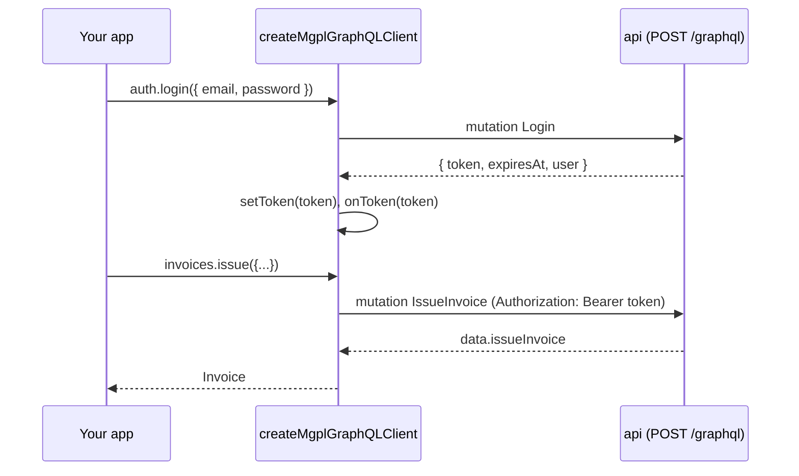

# GraphQL client: @mgpl-diagnostics/client

`createMgplGraphQLClient` talks to **mgpl-diagnostics/api**, the backend that serves everything at one
endpoint (`POST /graphql`). It has no dependencies: every operation is a plain string in
`src/graphql/operations.ts`, and the api's test suite validates each one against the server's schema.



## Options

```ts
createMgplGraphQLClient({
  url?: string;                    // default "/graphql"
  fetch?: typeof fetch;            // tests, SSR, retry wrappers
  token?: string | null;           // starting session token
  onToken?: (token: string | null) => void; // persist it where you want (or nowhere)
  headers?: HeadersInit | (() => HeadersInit | Promise<HeadersInit>);
  credentials?: RequestCredentials;
});
```

The client keeps the token in memory. `auth.login` sets it, `auth.logout` ends the session on the server
and clears it, and `setToken` / `getToken` let the app manage it directly.

## Conventions

- **Money is integer paise** (`totalPaise: 35400` is Rs 354.00). Catalog `mrp` and `priceList().rate` are rupees.
- **DateTime** is an ISO string; **Day** is `"YYYY-MM-DD"` in IST. The financial year runs April to March (`"2026-27"`).
- **Lists** take `limit` / `offset`; the server caps `limit` at 200.
- **Documents** come back as `{ format, fileName, mimeType, byteLength, base64, html }`: a PDF in `base64`,
  HTML (self-contained, fonts inlined) in `html`. `documentBlob(doc)` turns either into a Blob for
  `downloadBlob`, `openBlob` or `printBlob`. CSV exports come as `{ fileName, mimeType, content }`; use `csvBlob(file)`.
- The organisation and the acting user always come from the session. No method takes an `orgId`.

## Errors

Every failure throws `MgplGraphQLError` with a stable `code`:

| code | Meaning |
|---|---|
| `UNAUTHENTICATED` | No token, or it expired. Sign in again. |
| `FORBIDDEN` | The user lacks the permission (at that branch). |
| `NOT_FOUND` | The id does not exist in this organisation. |
| `BAD_USER_INPUT` | Validation failed; `message` says what. |
| `CONFLICT` | Duplicate or wrong state (e.g. releasing an unverified report). |
| `PERIOD_LOCKED` | The date is on or before a lock date. |
| `CREDIT_LIMIT_EXCEEDED` | A customer invoice would exceed the credit limit. |
| `INVALID_CREDENTIALS`, `ACCOUNT_DISABLED`, `INVITE_PENDING`, `ORG_REQUIRED`, `RATE_LIMITED` (with `extensions.retryAfterMs`), `WEAK_PASSWORD`, `INVALID_TOKEN` | auth-kit's codes, unchanged. |
| `NETWORK_ERROR` / `INTERNAL_SERVER_ERROR` | No response, or a server fault (details are masked). |

`error.errors` holds every GraphQL error, `error.status` the HTTP status, `error.data` any partial data.

## Custom selections

The typed methods select a fixed set of fields. For anything else, send your own document:

```ts
const data = await mgpl.request<{ patient: { name: string; invoices: { invoiceNo: string; duePaise: number }[] } }>(
  `query ($id: ID!) { patient(id: $id) { name invoices(limit: 5) { invoiceNo duePaise } } }`,
  { id },
);
```

`OPERATIONS[name].document` and `FRAGMENTS` are exported too, for GraphQL tools that want the strings.

## Methods

Each method runs one operation and returns its root field. Permissions are listed in the api's
docs (`docs/04-api-reference.md`).

### client (root)

| Method | GraphQL |
|---|---|
| `health` | query `health` |
| `ping` | mutation `ping` |

### auth

| Method | GraphQL |
|---|---|
| `login` | mutation `login` |
| `logout` | mutation `logout` |
| `viewer` | query `viewer` |
| `can` | query `viewer { can }` |
| `sessions` | query `mySessions` |
| `logoutOtherSessions` | mutation `logoutOtherSessions` |
| `revokeSession` | mutation `revokeSession` |
| `changePassword` | mutation `changePassword` |
| `requestPasswordReset` | mutation `requestPasswordReset` |
| `resetPassword` | mutation `resetPassword` |

### users

| Method | GraphQL |
|---|---|
| `list` | query `users` |
| `get` | query `user` |
| `create` | mutation `createUser` |
| `setRoles` | mutation `setUserRoles` |
| `disable` | mutation `disableUser` |
| `enable` | mutation `enableUser` |
| `setPassword` | mutation `setUserPassword` |
| `roles` | query `roles` |
| `upsertRole` | mutation `upsertRole` |
| `permissions` | query `permissions` |

### organization

| Method | GraphQL |
|---|---|
| `get` | query `organization` |
| `update` | mutation `updateOrganization` |
| `branches` | query `branches` |
| `branch` | query `branch` |
| `createBranch` | mutation `createBranch` |
| `updateBranch` | mutation `updateBranch` |
| `auditLog` | query `auditLog` |

### catalog

| Method | GraphQL |
|---|---|
| `search` | query `catalogSearch` |
| `test` | query `catalogTest` |
| `tests` | query `catalogTests` |
| `departments` | query `catalogDepartments` |
| `sampleTypes` | query `catalogSampleTypes` |
| `priceQuote` | query `priceQuote` |

### patients

| Method | GraphQL |
|---|---|
| `search` | query `patients` |
| `get` | query `patient` |
| `register` | mutation `registerPatient` |
| `update` | mutation `updatePatient` |

### doctors

| Method | GraphQL |
|---|---|
| `list` | query `doctors` |
| `create` | mutation `createDoctor` |
| `update` | mutation `updateDoctor` |

### bookings

| Method | GraphQL |
|---|---|
| `list` | query `bookings` |
| `get` | query `booking` |
| `create` | mutation `createBooking` |
| `cancel` | mutation `cancelBooking` |

### samples

| Method | GraphQL |
|---|---|
| `get` | query `sample` |
| `byBarcode` | query `sampleByBarcode` |
| `collect` | mutation `collectSample` |
| `receive` | mutation `receiveSample` |
| `reject` | mutation `rejectSample` |

### reports

| Method | GraphQL |
|---|---|
| `get` | query `report` |
| `create` | mutation `createReport` |
| `saveResults` | mutation `saveResults` |
| `verify` | mutation `verifyReport` |
| `release` | mutation `releaseReport` |
| `amend` | mutation `amendReport` |

### invoices

| Method | GraphQL |
|---|---|
| `list` | query `invoices` |
| `get` | query `invoice` |
| `issue` | mutation `issueInvoice` |
| `recordPayment` | mutation `recordPayment` |
| `refund` | mutation `refundPayment` |
| `cancel` | mutation `cancelInvoice` |

### books

| Method | GraphQL |
|---|---|
| `groups` | query `accountGroups` |
| `ledgers` | query `ledgers` |
| `ledger` | query `ledger` |
| `voucher` | query `voucher` |
| `ledgerStatement` | query `ledgerStatement` |
| `cashBook` | query `cashBook` |
| `trialBalance` | query `trialBalance` |
| `profitAndLoss` | query `profitAndLoss` |
| `balanceSheet` | query `balanceSheet` |
| `dayBook` | query `dayBook` |
| `outstandingReceivables` | query `outstandingReceivables` |
| `gstSummary` | query `gstSummary` |
| `setupChartOfAccounts` | mutation `setupChartOfAccounts` |
| `createLedger` | mutation `createLedger` |
| `postVoucher` | mutation `postVoucher` |
| `cancelVoucher` | mutation `cancelVoucher` |

### gst

| Method | GraphQL |
|---|---|
| `taxRules` | query `taxRules` |
| `addTaxRule` | mutation `addTaxRule` |
| `seedTaxRules` | mutation `seedTaxRules` |
| `config` | query `financeConfig` |
| `verifyWithCA` | query `verifyWithCA` |
| `gstr1` | query `gstr1` |
| `gstr3b` | query `gstr3b` |

### receivables

| Method | GraphQL |
|---|---|
| `customers` | query `customers` |
| `customer` | query `customer` |
| `createCustomer` | mutation `createCustomer` |
| `updateCustomer` | mutation `updateCustomer` |
| `issueInvoice` | mutation `issueCustomerInvoice` |
| `statement` | query `customerStatement` |
| `summary` | query `receivablesSummary` |
| `creditNotes` | query `creditNotes` |
| `creditNote` | query `creditNote` |
| `issueCreditNote` | mutation `issueCreditNote` |

### settlements

| Method | GraphQL |
|---|---|
| `partners` | query `partners` |
| `partner` | query `partner` |
| `createPartner` | mutation `createPartner` |
| `updatePartner` | mutation `updatePartner` |
| `addAgreement` | mutation `addAgreement` |
| `preview` | query `settlementPreview` |
| `list` | query `settlements` |
| `get` | query `settlement` |
| `create` | mutation `createSettlement` |
| `accrue` | mutation `accrueSettlement` |
| `pay` | mutation `paySettlement` |
| `cancel` | mutation `cancelSettlement` |

### cash

| Method | GraphQL |
|---|---|
| `closings` | query `cashClosings` |
| `closeDay` | mutation `closeCashDay` |

### bank

| Method | GraphQL |
|---|---|
| `statements` | query `bankStatements` |
| `lines` | query `bankLines` |
| `import` | mutation `importBankStatement` |
| `reconcile` | mutation `reconcileBank` |
| `match` | mutation `matchBankLine` |
| `setStatus` | mutation `setBankLineStatus` |
| `reconciliation` | query `bankReconciliation` |

### periods

| Method | GraphQL |
|---|---|
| `lockDates` | query `lockDates` |
| `setLockDate` | mutation `setLockDate` |
| `closeFinancialYear` | mutation `closeFinancialYear` |

### exports

| Method | GraphQL |
|---|---|
| `trialBalance` | query `exportTrialBalance` |
| `profitAndLoss` | query `exportProfitAndLoss` |
| `balanceSheet` | query `exportBalanceSheet` |
| `dayBook` | query `exportDayBook` |
| `ledger` | query `exportLedger` |
| `gstr1` | query `exportGstr1` |
| `gstr3b` | query `exportGstr3b` |
| `settlement` | query `exportSettlement` |

### documents

| Method | GraphQL |
|---|---|
| `templates` | query `reportTemplates` |
| `priceList` | query `priceList` |
| `reportSamples` | query `documentSamples` |
| `invoiceSamples` | query `invoiceSamples` |
| `renderReport` | query `renderReport` |
| `renderInvoice` | query `renderInvoice` |
| `invoiceTotals` | query `invoiceTotals` |
| `letterhead` | query `letterhead` |
| `invoice` | query `invoiceDocument` |
| `bookingReports` | query `bookingReportDocument` |
