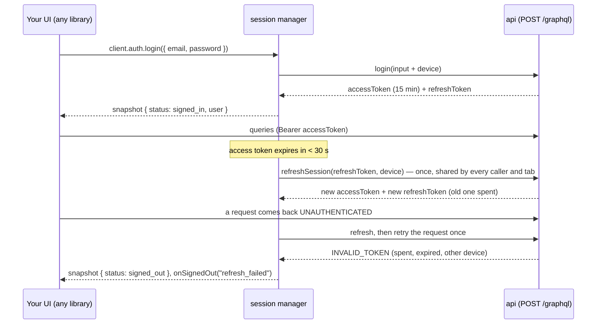

# Sessions, tokens and device signals

The API signs users in with **two tokens**:

- a short-lived **access token**: a JWT sent as `Authorization: Bearer`, 15 minutes by default;
- a long-lived, single-use **refresh token**, which buys the next pair (`refreshSession`).

The SDK's **session manager** handles them for you, with no dependency and no framework:

- it keeps the tokens in memory by default, or in storage you choose;
- it refreshes shortly before the access token expires, and once more if a request comes back
  `UNAUTHENTICATED`;
- one refresh at a time: parallel requests share it, and so do tabs (Web Locks);
- it tells any UI library when the session changes;
- it sends **device signals** with login and refresh, so the server can bind the refresh token to the device.



## Setup

```ts
import { createMgplGraphQLClient, createSessionManager, webSessionStorage } from "@mgpl-diagnostics/client";

// default: tokens in memory (lost on reload; safest against XSS)
const mgpl = createMgplGraphQLClient({ url: "https://api.your-lab.in/graphql" });

// or: survive reloads and sync tabs (localStorage is readable by any script on the page)
const session = createSessionManager({
  url: "https://api.your-lab.in/graphql",
  storage: webSessionStorage(),            // or memorySessionStorage(), or your own SessionStorage
  onSignedOut: (reason) => router.push("/login"),
});
const mgpl2 = createMgplGraphQLClient({ url: "https://api.your-lab.in/graphql", session });

await mgpl2.auth.login({ email, password });   // device signals are added for you
await mgpl2.auth.logout();                     // ends the server session (by refresh token), clears storage
```

`SessionStorage` is `{ get(), set(value), subscribe?(listener) }`. On React Native, implement it on
SecureStore or Keychain; in Electron, on safeStorage.

| Session manager | |
| --- | --- |
| `getSnapshot()` / `subscribe(listener)` | `{ status, user, accessExpiresAt, refreshExpiresAt }`; same object until it changes |
| `store` | Svelte-style readable store |
| `accessToken()` | a valid access token (refreshed first when needed) or null |
| `refresh()` | single-flight refresh; true when it worked |
| `signIn(result)` / `signOut(reason?)` / `current()` | keep, forget or read the tokens |
| `headers()` | `{ authorization }` for clients that take a headers function |
| `fetch` | a fetch that adds the token and refreshes and retries once on `UNAUTHENTICATED` |
| `device()` | the device signals |

Options: `url`, `fetch`, `storage`, `device` (a collector, or `false`), `refreshMarginMs` (default 30 s),
`headers`, `onSignedOut`.

## Any UI or data library

```tsx
// React
import { useMgplSession } from "@mgpl-diagnostics/client/react";
const { status, user } = useMgplSession(mgpl.session);   // useSyncExternalStore underneath

// Svelte
{#if $store.status === "signed_in"} … {/if}               // const store = mgpl.session.store

// Vue
const s = shallowRef(mgpl.session.getSnapshot());
onScopeDispose(mgpl.session.subscribe((v) => (s.value = v)));
```

### TanStack Query (React, Vue, Svelte, Solid, Angular)

```ts
import { mgplQuery, mgplMutation, mgplKey, clearOnSignOut } from "@mgpl-diagnostics/client";

const invoices = useQuery(mgplQuery(mgpl, "invoices", { limit: 20 }));       // { queryKey, queryFn }
const issue = useMutation({ ...mgplMutation(mgpl, "issueInvoice"), onSuccess: () => qc.invalidateQueries({ queryKey: ["mgpl", "invoices"] }) });
clearOnSignOut(mgpl.session, qc);                                             // no cached data after logout
```

Keys are `["mgpl", operationName, variables]`; invalidate `["mgpl"]` to refetch everything. Typed
methods work too: `queryFn: () => mgpl.invoices.list({ limit: 20 })`.

### SWR, RTK Query, Apollo, urql, graphql-request

```ts
useSWR(mgplKey("invoices", { limit: 20 }), mgplFetcher(mgpl));                // SWR
new HttpLink({ uri: "https://api.your-lab.in/graphql", fetch: session.fetch }); // Apollo
createClient({ url: "https://api.your-lab.in/graphql", fetch: session.fetch, exchanges: [fetchExchange] }); // urql
new GraphQLClient(url, { fetch: session.fetch });                            // graphql-request
fetchBaseQuery({ baseUrl, fetchFn: session.fetch });                          // RTK Query
```

## Device signals

Login and refresh carry `device: { deviceId, fingerprint, clientSessionId, info }`. The server stores
them on the session. A refresh from **another `deviceId` ends the session** (`DEVICE_BINDING=enforce`,
the default), so a stolen refresh token does not work elsewhere. A changed fingerprint is only logged,
because browser updates change it.

| Signal | What it is | Where it comes from |
| --- | --- | --- |
| `deviceId` | random id, created once | `localStorage` key `mgpl.deviceId` (memory where unavailable) |
| `clientSessionId` | random id per tab or app run | `sessionStorage` key `mgpl.tabId` |
| `fingerprint` | SHA-256 (32 hex characters) of OS, browser family, mobile, platform, language, time zone, screen size, colour depth, CPU cores, device memory and touch points; the browser version is left out so updates don't change it | WebCrypto |
| `info` | `os`, `browser`, `browserVersion` (major only), `mobile`, `language`, `timezone`, `screen`, plus your `extraInfo` | `navigator`, `screen`, `Intl` |

The values are collected by [security-kit](https://github.com/mgpl-diagnostics/security-kit)
(`@mgpl-diagnostics/security-kit/browser`), which is bundled into this package, so the SDK still has no
runtime dependency. Devices that signed in before 1.3.0 keep their `deviceId`.

Nothing else is read: no canvas, audio, font or IP probing, and no third-party script. Tell your users
in your privacy notice that these values are used to keep their account secure.

```ts
import { createDeviceCollector } from "@mgpl-diagnostics/client";

const device = createDeviceCollector({
  store: secureStoreAdapter,                                      // React Native: keep the id in SecureStore
  extraInfo: () => ({ appVersion: "2.3.0", model: Device.modelName }),
  exclude: ["screen"],
});
const session = createSessionManager({ url, device });             // or device: false to send none
```

To share one collector with the rest of your app (for example security-kit's `signalFetch` or
`useDeviceSignals`), pass it in:

```ts
import { createSignalCollector } from "@mgpl-diagnostics/security-kit/browser";

const signals = createSignalCollector({ app: "lab-panel@1.4.0" });
const device = createDeviceCollector({ signals }); // the session manager sends the same ids
```
